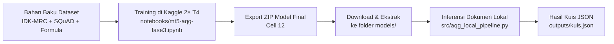

# AjarinDong: Bilingual Answer-Aware Question Generation (AQG)

Sistem Automatic Question Generation (AQG) bilingual (Bahasa Indonesia & Bahasa Inggris) berbasis model `google/mt5-base`. Model ini dirancang khusus untuk memproses materi kuliah/sekolah dari dokumen PDF, presentasi PPTX (poin materi singkat), dan Word (DOCX), termasuk materi sains, matematika, ekonomi, dan teknik yang memuat notasi rumus.

---

## 📁 Struktur Repositori

```text
AjarinDong/
│
├── .gitignore                          # Aturan git: mengabaikan .agents/, bobot model, cache, zip
├── README.md                           # Dokumentasi proyek & panduan workflow
│
├── notebooks/                          # Eksperimen & training model di cloud (Kaggle)
│   ├── mt5-aqg-fase3.ipynb             # [UTAMA] Two-Stage Curriculum Fine-Tuning DDP T4×2
│   ├── mt5_aqg_phase2_kaggle.ipynb     # [Arsip] Eksperimen Fase 2
│   └── mt5-aqg-ajarindong.ipynb        # [Arsip] Eksperimen Fase 1
│
├── src/                                # Pipeline inferensi & ekstraksi kuis lokal
│   ├── __init__.py
│   ├── aqg_local_pipeline.py           # Engine ekstraksi dokumen (PDF/PPTX/DOCX) -> Kuis JSON
│   ├── test_aqg_local_pipeline.py      # Unit tests
│   ├── requirements.txt                # Dependensi parser & inferensi lokal
│   └── aqg_demo_output.json            # Sampel keluaran demo kuis
│
├── docs/                               # Dokumentasi tambahan & catatan riset
│   └── README_AQG_FASE2.md             # Catatan temuan dan batasan Fase 2
│
├── models/                             # Folder lokal target untuk ekstrak model ZIP dari Kaggle (di-ignore git)
│   └── .gitkeep
│
└── outputs/                            # Folder lokal target untuk menyimpan file kuis JSON hasil generate (di-ignore git)
    └── .gitkeep
```

---

## 🚀 Alur Kerja (Workflow)

Proyek ini memisahkan secara tegas antara **Training (Cloud Kaggle)** dan **Inferensi (Lokal)**:



### Tahap 1: Training di Cloud (Kaggle)
1. Buka [notebooks/mt5-aqg-fase3.ipynb](file:///d:/Kuliah/DEV/AjarinDong/notebooks/mt5-aqg-fase3.ipynb) di Kaggle.
2. Pastikan Accelerator diatur ke **GPU T4 × 2** dan **Internet: On**.
3. Jalankan dari Cell 1 sampai Cell 9 (Training Two-Stage Curriculum).
4. Setelah training selesai, jalankan Cell 10 (Evaluasi Mendalam), Cell 11 (Quiz Generator), dan Cell 12 (Auto-ZIP).
5. Unduh file `mt5_base_aqg_complete_bundle.zip` yang dihasilkan di Cell 12.

### Tahap 2: Inferensi & Pembuatan Soal di Lokal
1. Ekstrak isi file ZIP dari Kaggle ke dalam folder `models/mt5-base-aqg-final`.
2. Di lingkungan Conda lokal (`C:\Users\farro\anaconda3\envs\sisarasa`):
   ```bash
   pip install -r src/requirements.txt
   ```
3. Jalankan pipeline lokal untuk membuat kuis dari file PDF, PPTX, atau DOCX:
   ```bash
   python src/aqg_local_pipeline.py --input materi_kuliah.pdf --model-dir ./models/mt5-base-aqg-final --output outputs/kuis.json
   ```

### Tahap 3: Menjalankan Unit Test Lokal
```bash
python -m unittest discover -s src -p "test_*.py" -v
```
*(Gunakan Python dari Conda environment)*

---

## 🛡️ Aturan Git
* Direktori `.agents/` diabaikan secara ketat oleh `.gitignore` untuk menjaga privasi aturan agen lokal.
* Bobot model berukuran besar (`*.safetensors`, `*.bin`, `spiece.model`), checkpoint, dan file ZIP otomatis diabaikan agar repositori tetap ringan.
